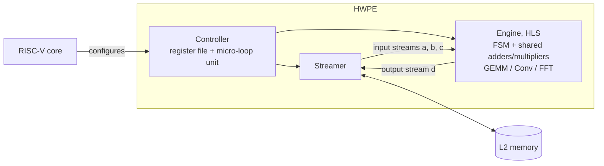

# Reprogrammable HWPE Accelerator for 5G/6G Baseband Kernels

A single Hardware Processing Engine (HWPE) for the [PULPissimo](https://github.com/pulp-platform/pulpissimo) RISC-V SoC that computes **matrix multiplication (GEMM), convolution and FFT/IFFT on one shared set of adders and multipliers**. An FSM switches the datapath between the three operations; the RISC-V core selects the operation through the HWPE register file at the start of each job.

The kernels come from decomposing OFDM/MIMO baseband processing into a few reusable compute blocks, so the hardware stays useful as the standards evolve.

This is the final implementation from my diploma thesis, [*RISC-V Architectures for 6G Based on RISC-V Processing with Emphasis on Virtualization Techniques*](https://hdl.handle.net/10889/33055) (University of Patras, 2026).

**`FFT_opt/` is the final version of the accelerator.**

## Results

Cycle counts from cycle-accurate simulation (QuestaSim), compared with a naive single-core RISC-V baseline (RI5CY core, -O3).

| Kernel | Size | Speedup vs. baseline |
| --- | --- | --- |
| GEMM | 32×32 (8×8 tiles) | **9.86×** |
| Convolution | 512-sample signal, 127-tap filter | **5.31×** |
| FFT | 1024 points | **6.46×** |
| FFT | 512 points | 7.06× |

Resources (Vitis HLS estimates, Xilinx ZCU104 target): under 1% of DSPs, under 6% of LUTs, about 222 MHz.

A dedicated GEMM-only tiled engine ([repo](https://github.com/M-An0s/HWPE_INTEGRATED_NXN_MATRIX_4_TILLING)) reaches up to 108× at 32×32 and serves as a performance upper bound for this design.

## Architecture

- **Engine (Vitis HLS):** loads input buffers from the HWPE streams, then runs the selected operation on the shared datapath. In this configuration one job computes a 4×4 matrix product, a 16-tap convolution or an 8-point FFT. Larger problems are built from repeated jobs.
- **Controller (SystemVerilog):** extended with new registers, including the function select and strides that use the HWPE micro-loop unit to generate the FFT's access pattern.
- **Data types:** 32-bit words. The FFT uses Q15 fixed point; GEMM and convolution use integers.

Larger problem sizes use the RISC-V core for part of the work: tiling for GEMM (4×4 and 8×8 tiles), overlap-add for convolution, and the final radix-2 stage of the 1024-point FFT.

## Improvements over the first version

Compared with the [original implementation](https://github.com/M-An0s/HWPE-integration-in-Pulpissimo-for-6G-Algorithms):

- Fixed a bug in the streaming interface protocol, so the HWPE can be triggered continuously without leftover data in the stream FIFOs.
- Pipelined the datapath to raise the clock frequency.

## Verification

1. Vitis HLS C simulation and C/RTL co-simulation of the engine.
2. System-level simulation in QuestaSim with a RISC-V testbench (`my_tb.c`, built on [hwpe-tb](https://github.com/pulp-platform/hwpe-tb)): random inputs at multiple sizes, checked against Python-generated golden vectors, bit-accurate for the multi-stage Q15 FFT.

## Repository structure

| Path | Contents |
| --- | --- |
| `FFT_opt/` | Final HLS source of the accelerator |
| `FFT/` | earlier version (general FFT controls) |
| `my_FFT_configs/` | Configurations to the HWPE to support FFT addressing |
| `my_tb.c` | RISC-V testbench and experiment example for GEMM (tile offloading, golden-vector checks) |

## How to run

The design is tested inside [hwpe-tb](https://github.com/pulp-platform/hwpe-tb):

1. Synthesize `FFT_opt` in Vitis HLS and copy the generated Verilog into hwpe-tb, replacing `mac_engine.sv`.
2. In `mac_fsm`, set the transaction and line lengths to match the number of inputs on each stream.
3. In `mac_top`, instantiate the engine in place of the MAC engine (port mapping in the [original repo](https://github.com/M-An0s/HWPE-integration-in-Pulpissimo-for-6G-Algorithms)).
4. Build and run `my_tb.c` on the RISC-V core in QuestaSim.

## Author

Emmanouil (Manos) Spyridakis · [LinkedIn](https://www.linkedin.com/in/manos-spyridakis-a8b832416/) · Applied Electronics Laboratory (APEL), University of Patras
